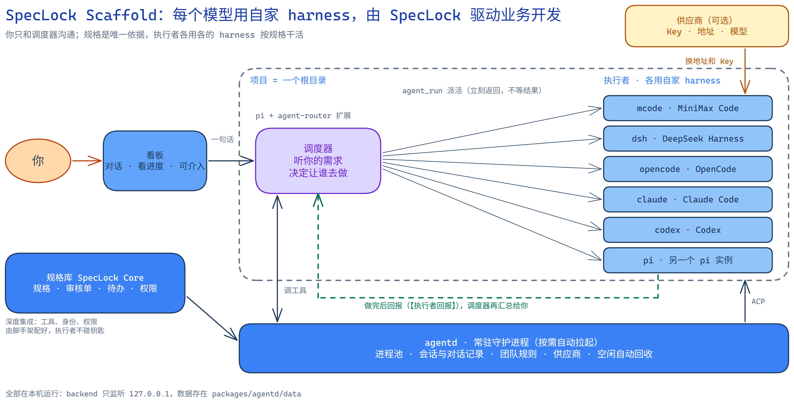
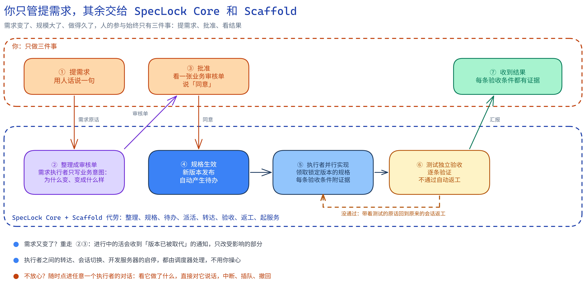

# SpecLock Scaffold

**你只管提需求。** 每个模型跑在自己家的 harness 里，由 [SpecLock Core](https://github.com/leaveWhite9088/speclock-core) 管着规格，一群执行者按规格把活干完、验完。专为**业务驱动的开发**设计：需求会变、规模会大、周期会长，你的参与始终只有三件事：提需求、批准、看结果。



## 为什么用它

**每个模型用自己家的 harness。**
MiniMax 用 MiniMax Code，DeepSeek 用 DeepSeek Harness，Kimi 用 Kimi Code，Claude 用 Claude Code，GPT 用 Codex，Gemini 用 Antigravity，另外还有 OpenCode 和 pi。不用一个通用壳去套所有模型，每个模型都在最熟悉的环境里干活，一个项目里随便混用。要接别家的模型，填一次地址和 Key，支持第三方供应商的 harness 都能直接用。

**和 SpecLock 深度集成，规格是唯一依据。**
业务按「大业务 → 小业务 → 模块」组织，每个模块有规则（R-n）、验收条件（AC-n）和接口。需求怎么变、谁来批准、哪个版本生效，都由规格库记录和把关。执行者只按锁定版本的规格干活，不猜；实现者不能验收自己的活，必须由独立的测试执行者逐条验收。工具、身份和权限由脚手架配好，执行者碰不到钥匙。

**为超长程任务和复杂的业务变更而设计。**
- 规格是持久的真相，不靠某次对话的记忆；一个模块一个会话，上下文不会串。
- 上下文快满了可以自动压缩，也可以生成交接文档、换新会话接着干，旧会话保留。
- 需求变了：先出审核单，你同意才生效；进行中的活会收到「版本已被取代」的通知，只改受影响的部分，没受影响的验收证据可以沿用。
- 每个执行者的对话都记在本地，随时回看。

**你只和调度器沟通，省下的是你的精力。**
派活、选执行者、在执行者之间转达问题、测试不过后的返工、启停开发服务器，都由调度器处理。它给你看的是人话写的业务审核单和最终结果，而不是一堆技术细节。

**执行者的对话是开放的，不对劲就能手动干预。**
点进任何一个执行者，能看到它的工具调用和思考过程，可以直接对它说话、中断它、给排队的任务插队或撤回。调度器派活不阻塞：派出去就能接着聊，做完的结果自己回来。

**角色即插即用，自带常用模板。**
执行者的用途、目录、CLI 和规格角色都能自由配置。自带七个软件开发常用的模板：业务分析师、产品经理、前端开发工程师、后端开发工程师、数据开发工程师、测试工程师、规格审查员。改模板，用它创建的执行者下次启动就用新提示词。

## 一个需求是怎么落地的



1. **你提需求**，用人话说一句。
2. **需求执行者整理成审核单**，只写业务意图：为什么变、变成什么样、验收条件。新开一块业务时，它会先给你一张结构轮廓，你认可了才写审核单。
3. **你批准**：调度器把审核单用人话讲给你听，你明确说「同意」才算数，它不会替你批准。
4. **规格生效，自动产生待办**，每条待办是一个模块的一个版本。
5. **执行者并行实现**：调度器指定负责人，其他人是参与者，各领各的部分；每条验收条件都要附证据。
6. **测试独立验收**，逐条验证；不通过，带着测试的原话回到原来的会话返工。
7. **结果回到你这里**，每条验收条件都有证据。

## 角色

规格库里有四种角色，给执行者选一个「规格角色」就接入了：

| 角色 | 做什么 |
| --- | --- |
| 需求 | 理解业务、整理变更、维护规格；你只通过审核单和它沟通 |
| 执行 | 按规格实现，每条验收条件附证据；不改规格、不验收 |
| 测试 | 独立验收，是最后一道关 |
| 扫描 | 通读规格找矛盾、含糊和没法验证的条件，只提建议 |

不接入规格库也能用：执行者的规格角色选「不接入」，调度器照样派活、汇总。

## 上手

前置：[Node.js](https://nodejs.org)，以及你想用的 CLI（装好并登录）。

```powershell
npm install
npm run backend      # 终端 1：网关，第一次请求时自动拉起 agentd
npm run web          # 终端 2：看板，浏览器打开 http://127.0.0.1:5234
```

不确定本机装了哪些 CLI？运行 `npm run preflight`，它只检查、不改任何东西。要用规格库，装好 `git` 和 `uv` 后运行一次：

```powershell
npm run preflight -- core --yes
```

然后在看板里：**建项目**（选一个根目录）→ **建执行者**（选模板，或自己选 CLI、子目录、用途、规格角色）→ **对调度器说话**，不用提工具名：

```
我们要加一个会员积分功能：下单按金额累计积分，积分可以抵扣下一单
把「会员积分」的规则改一下：积分有效期从一年改成半年
做一次规格检查
```

也可以直接点进某个执行者，和它单独对话。

## 文档

| 想了解 | 看这里 |
| --- | --- |
| 全部工具、配置项、环境变量、预检、供应商细节、运维命令 | [docs/REFERENCE.md](docs/REFERENCE.md) |
| 代码怎么分层、每个包做什么 | [ARCHITECTURE.md](ARCHITECTURE.md) |
| 踩过的坑和实测数据 | [LESSONS.md](LESSONS.md) |

## 开发

仓库是 npm workspaces：`agentd`（调度守护进程）、`drivers`（每个 CLI 一个驱动）、`preflight`（预检）、`backend`（网关）、`web`（看板，React + Vite）。

```powershell
npm test                   # 在私有守护进程上跑整套回归，不碰你正在用的那个
npm run restart-daemon     # 让守护进程用上新代码；有任务在跑就拒绝
```

某个 CLI 升级后行为变了，主要改它的驱动（`packages/drivers/<cli>.mjs`）。
